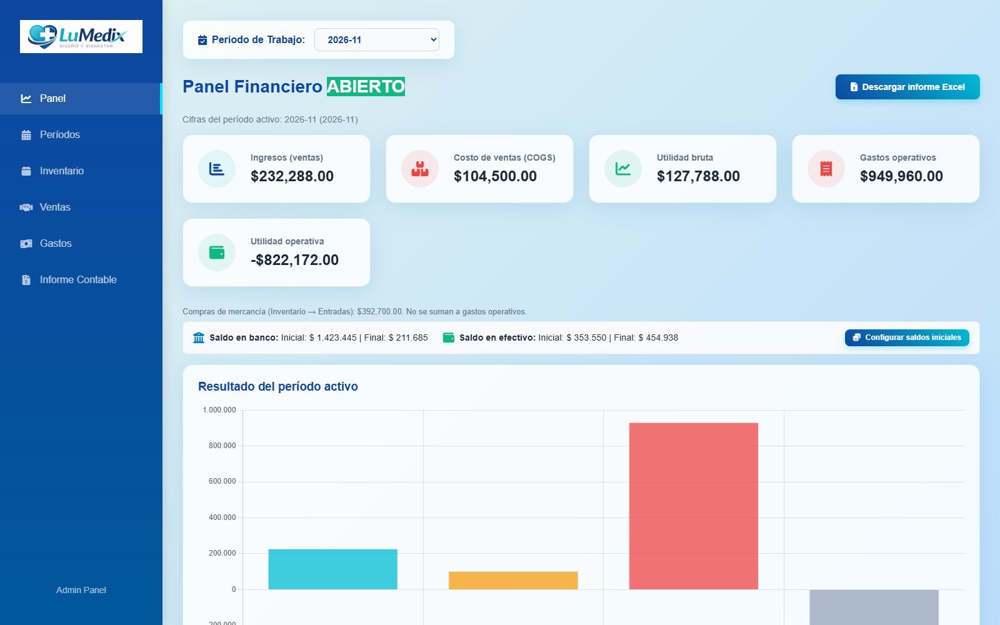
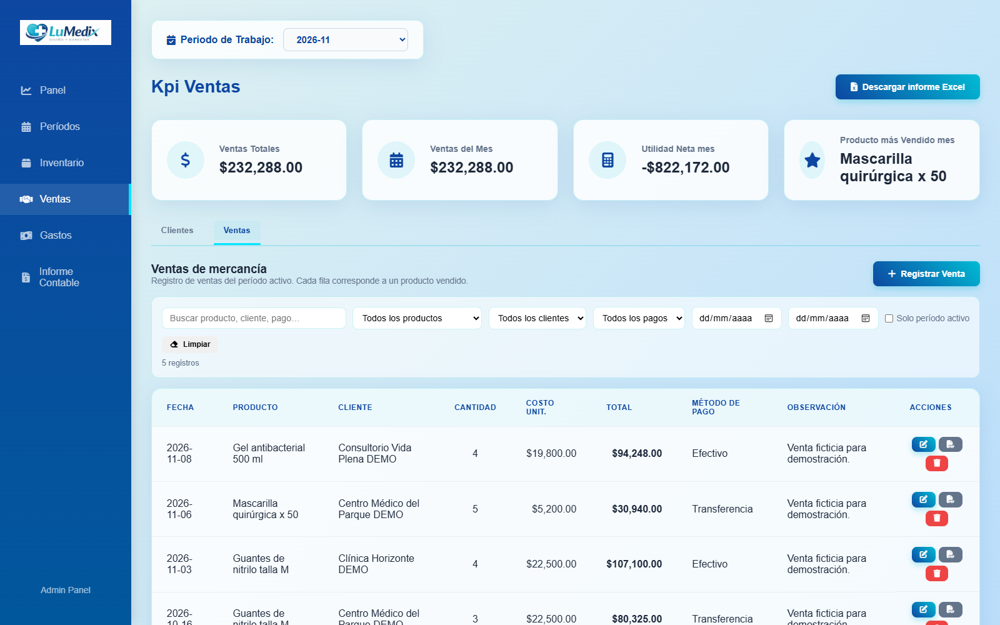
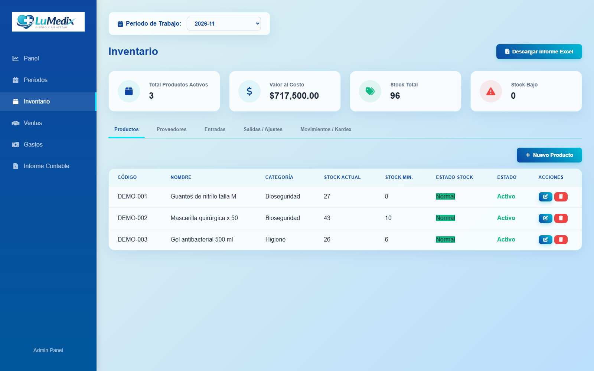
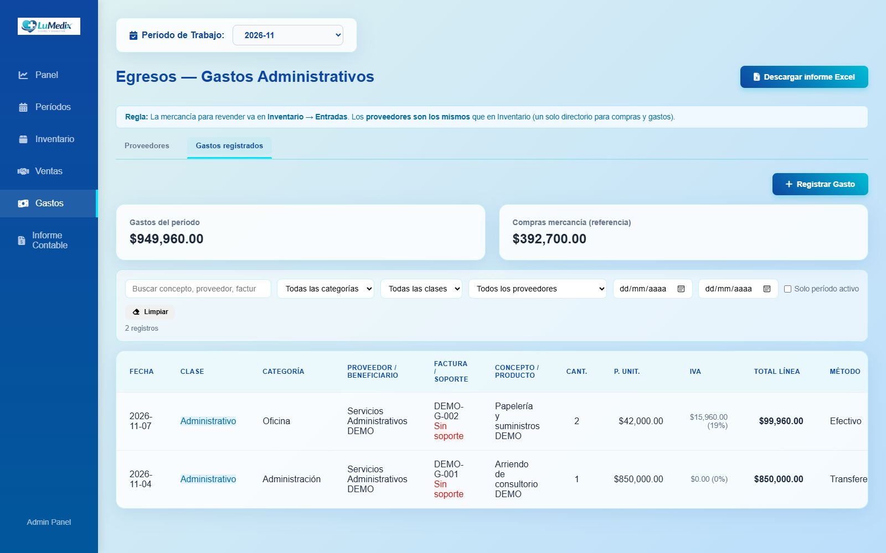
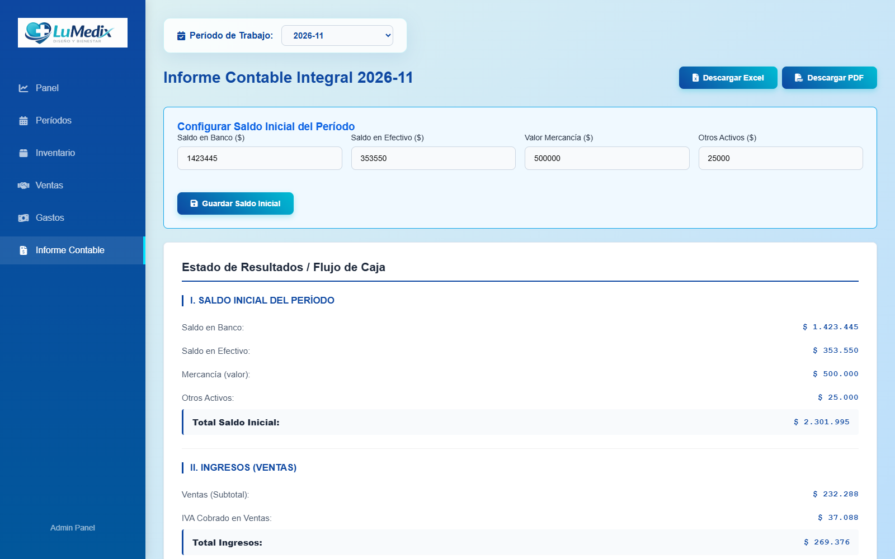

# LuMedix | Gestión empresarial

**Inventario, ventas, gastos e indicadores financieros en una misma aplicación.**

Proyecto de portafolio de **Juan Soto**, desarrollado con Node.js, Express, SQLite y JavaScript. LuMedix reúne operaciones comerciales y reportes para consultar el estado de un negocio por períodos.

> **Demostración con datos ficticios.** Este repositorio no incluye bases de datos, facturas ni información de clientes reales. La aplicación funciona localmente; este enlace de GitHub permite explorar y descargar el código.

[Ver el video](docs/demo-lumedix.webm) · [Explorar las funciones](#funciones-principales) · [Ejecutar en tu computador](#cómo-probar-la-aplicación) · [Seguridad](SECURITY.md)

## ¿Qué problema aborda?

Llevar productos, ventas y gastos en registros separados dificulta consultar las existencias, seguir los movimientos y entender los resultados de un período. LuMedix propone un flujo integrado: registrar operaciones, consultar su detalle y revisar indicadores e informes desde una misma interfaz.

El proyecto combina **gestión de procesos de negocio**, **persistencia de datos** y **presentación de información financiera** en una aplicación web que se ejecuta en el computador del usuario.

## Recorrido en video

**[Abrir o descargar el video de demostración](docs/demo-lumedix.webm)**

Recorrido de la interfaz, sin audio y con rótulos explicativos: panel financiero, inventario, movimientos, ventas, gastos e informe contable. Todos los registros mostrados son ficticios. Si GitHub no lo reproduce en la página, descarga el archivo WebM y ábrelo en tu navegador o reproductor.

## Funciones principales

| Módulo | Qué permite hacer |
| --- | --- |
| Panel financiero | Consultar ingresos, costo de ventas, utilidad bruta, gastos y resultado del período. |
| Inventario | Administrar productos y proveedores, consultar existencias y revisar entradas, salidas y movimientos. |
| Ventas | Gestionar clientes, registrar ventas y consultar operaciones con filtros. |
| Gastos | Registrar gastos, consultar proveedores y asociar soportes PDF. |
| Períodos | Seleccionar el período de trabajo y gestionar su apertura y cierre. |
| Informe contable | Consultar saldos iniciales, resultados y flujo de caja; exportar información a Excel y PDF. |

### Inventario y existencias

### Registro de ventas

### Control de gastos

### Informe contable

## Tecnologías y organización

| Componente | Tecnología |
| --- | --- |
| Interfaz | HTML, CSS y JavaScript |
| Servidor y API | Node.js y Express |
| Persistencia local | SQLite mediante sqlite3 |
| Visualización | Chart.js |
| Exportación | SheetJS, jsPDF y AutoTable |
| Comprobaciones | Node.js Test Runner y GitHub Actions |

La interfaz consulta una API Express. El servidor guarda los registros en SQLite y los adjuntos PDF en una carpeta local. Las dependencias de la interfaz se sirven desde los paquetes instalados, sin cargar scripts de CDN al navegar.

~~~text
public/                    Interfaz, estilos y recursos visuales
server.js                  Servidor Express y operaciones de la API
lib/files.js               Validación de rutas y adjuntos
scripts/seed-demo-data.js  Generador de información ficticia
scripts/check-publish.js   Comprobación de archivos destinados a Git
test/                      Pruebas de regresión de seguridad
docs/                      Capturas y video del portafolio
~~~

## Cómo probar la aplicación

**Requisito:** Node.js 24 LTS con npm. Git es opcional si descargas el ZIP.

1. En GitHub, selecciona **Code → Download ZIP** y extrae la carpeta. También puedes clonar el repositorio:

   ~~~sh
   git clone https://github.com/Juan98383/Lumedix_Portafolio.git
   cd Lumedix_Portafolio
   ~~~

2. Abre una terminal en la carpeta que contiene `package.json` e instala las dependencias:

   ~~~sh
   npm ci
   ~~~

3. Inicia la aplicación:

   ~~~sh
   npm start
   ~~~

4. Abre **http://127.0.0.1:3100** en el navegador. Mantén la terminal abierta mientras la utilizas. Para detenerla, presiona **Ctrl+C**.

En el primer inicio se crea `data/lumedix-demo.db` con datos ficticios. Cada persona tiene su propia base local: sus cambios no modifican este repositorio ni la instalación de otra persona. El generador no reemplaza una base que ya contenga información.

La instalación inicial requiere Internet, incluido el servidor oficial de SheetJS. Si el puerto 3100 está ocupado, detén la otra instancia o configura `PORT` antes de iniciar.

## Comprobaciones y privacidad

~~~sh
npm test
npm audit
npm run check:publish
~~~

La última comprobación requiere Git y archivos añadidos al repositorio. Ayuda a detectar bases, adjuntos, respaldos y ciertos patrones de secretos; no sustituye una revisión humana.

- `data/`, `uploads/`, bases SQLite, archivos de entorno y `node_modules/` están excluidos de Git.
- Se validan las rutas y el formato de los adjuntos PDF y se escapan datos mostrados en las plantillas HTML.
- La carga demo conserva las bases existentes y se desactivó la reconciliación automática destructiva.
- GitHub Actions ejecuta pruebas, comprobaciones de publicación y auditoría de dependencias.

Detalles de controles y límites en [SECURITY.md](SECURITY.md). Evidencia de las comprobaciones realizadas en [VALIDACION.md](VALIDACION.md).

## Alcance del proyecto

Esta versión es una **demostración local de portafolio**, sin autenticación multiusuario. Los informes ilustran la lógica implementada y no se presentan como una solución contable certificada.

GitHub aloja el código; **GitHub Pages no ejecuta este servidor Node.js ni su base SQLite**. Para una demostración pública se requiere preparar autenticación, autorización, HTTPS, almacenamiento y operación del servidor.

## Autor

**Juan Soto** · [Perfil de GitHub](https://github.com/Juan98383)

Proyecto de portafolio que integra gestión comercial, desarrollo web y presentación de indicadores. El repositorio no incorpora una licencia de redistribución del código propio; las dependencias mantienen sus respectivas licencias.
